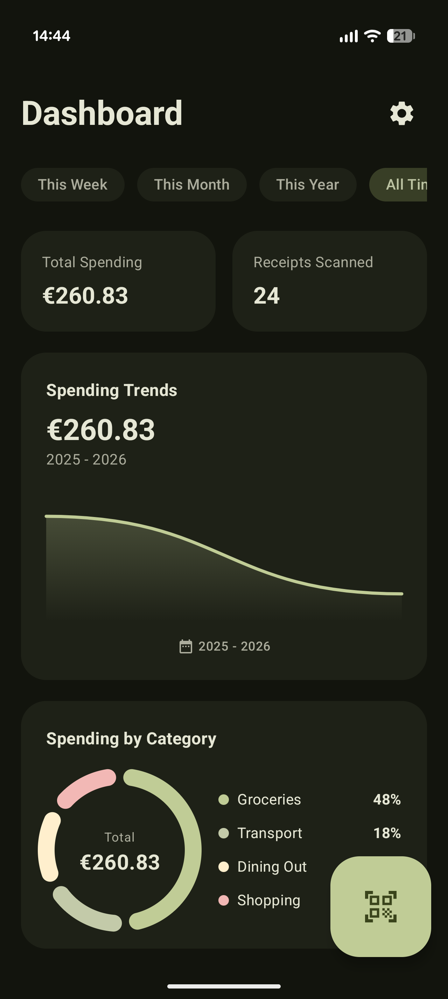
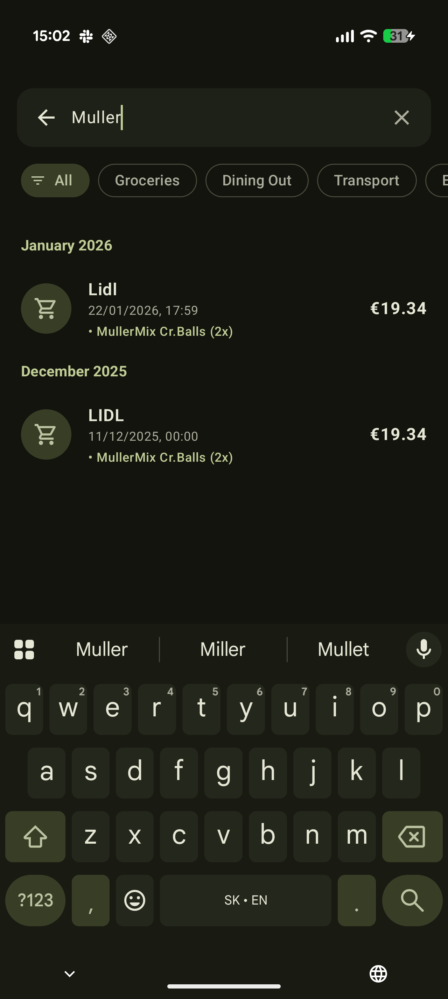
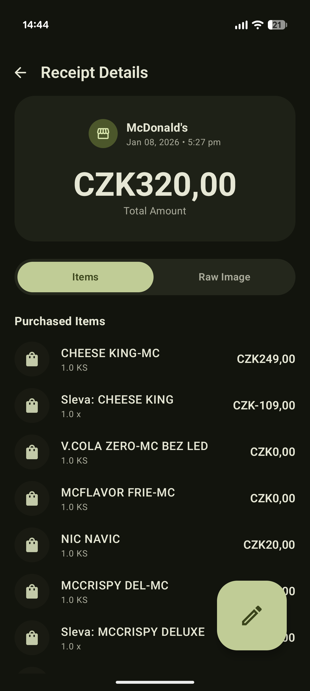

# Receipts

**Receipts** is an Android application designed to help you manage and organize your receipts with ease. Leveraging the power of the Google Gemini API, it offers advanced full-text search capabilities, allowing you to find any receipt by its content.

## Features

*   **Receipt Management**: Store and organize all your receipts in one place.
*   **AI-Powered Search**: Utilize full-text search to find receipts based on items, merchants, or dates, powered by Google's Gemini API.
*   **Customizable Settings**:
    *   Set your preferred currency (EUR, USD, etc.).
    *   Choose your preferred AI Model (e.g., `gemini-flash-latest`).

## Screenshots

| Dashboard | Search | Receipt Details |
|:---:|:---:|:---:|
|  |  |  |

## Setup & Configuration

This application requires a Google Gemini API Key to perform full-text searches and analysis.

### 1. Get a Free API Key
1.  Go to [Google AI Studio](https://aistudio.google.com/).
2.  Sign in with your Google account.
3.  Click on **"Get API key"** to create a free API key.

### 2. Configure the App
1.  Open the **Receipts** app on your Android device.
2.  Navigate to the **Settings** screen.
3.  Enter your API Key in the **API Key** field.
4.  (Optional) Select your preferred **AI Model** and **Currency**.

## Built With
*   [Kotlin](https://kotlinlang.org/)
*   [Jetpack Compose](https://developer.android.com/jetpack/compose)
*   [Google Gemini API](https://ai.google.dev/)
